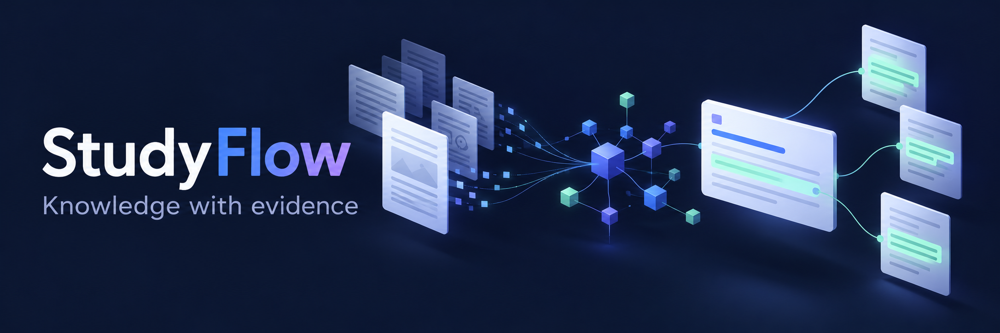
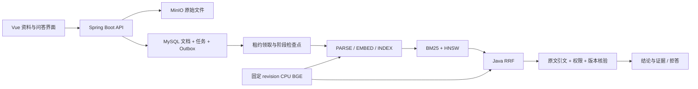

<div align="center">



# StudyFlow

**让学习资料可检索，让每条结论有原文可查。**

[](studyflow/pom.xml)
[](studyflow/pom.xml)
[](studyflow-web/package.json)
[](retrieval-lab/README.md)
[](retrieval-lab/model-lock.json)
[](studyflow/docs/highlights-verification.md)

[项目亮点](#项目亮点) · [链路与架构](#链路与架构) · [快速开始](#快速开始) · [验证结果](#验证结果) · [文档导航](#文档导航)

</div>

---

StudyFlow 是面向个人学习与私有资料研究的知识库。PDF、TXT、Markdown 和图片经持久任务处理后进入检索；问答返回结论、引用原文与位置，用户能直接核对来源。Vue 前端支持资料管理、检索、问答、历史会话和只读学习 Agent。

## 项目亮点

| 能力 | 关键技术 | 可以解释的工程问题 |
| :--- | :--- | :--- |
| **可评测混合检索** | ES BM25 / HNSW、CPU BGE、固定 revision、Java RRF | 语义与关键词互补召回；用同一语料比较五种检索模式 |
| **结论与证据绑定** | 严格 JSON、来源白名单、连续引文、UTF-16 位置、独立核验请求 | 伪造引用拒绝发布；重建后的历史证据明确标记版本 |
| **可恢复文档流水线** | 事务 Outbox、阶段检查点、心跳与租约 fencing、generation | 崩溃后继续原任务；旧 worker 无法覆盖新版本 |

同时提供分片上传、PDFBox / PaddleOCR 分流、上下文预算、SSE 状态推送和只读 Agent 工具。完整模块与接口说明见[详细项目指南](studyflow/docs/project-guide.md)。

## 链路与架构


*动图为资料与问答链路示意；问答验证结果见下方实测说明。*

<details>
<summary><strong>展开静态架构图</strong></summary>



</details>

## 快速开始

需要 **JDK 21、Maven 3.9+、Node.js 20+、Docker Compose**。以下 Bash 命令从仓库根目录执行。

### 后端与基础设施

```bash
cd studyflow
docker compose up -d mysql redis minio elasticsearch
STUDYFLOW_MQ_MODE=async STUDYFLOW_OCR_ENABLED=false mvn spring-boot:run
```

此模式使用本地异步执行器、mock AI 和 mock embedding，可体验 TXT / Markdown / 文本型 PDF 链路。mock 问答只输出原文摘录，并在页面标记；真实语义检索需配置 BGE。

### 前端

在另一个终端，从仓库根目录执行：

```bash
cd studyflow-web
npm ci
npm run dev
```

| 入口 | 地址 |
| :--- | :--- |
| 前端 | `http://localhost:5173` |
| API / Knife4j | `http://localhost:8080` / `http://localhost:8080/doc.html` |
| MinIO 控制台 | `http://localhost:9001` |
| Elasticsearch | `http://localhost:9200` |

真实 BGE 侧车、模型身份与新索引配置见[检索实验指南](retrieval-lab/README.md)。RocketMQ、PaddleOCR 和外部模型接入见[详细项目指南](studyflow/docs/project-guide.md)。

### 构建与验证

```bash
cd studyflow
mvn verify
```

```bash
cd studyflow-web
npm ci
npm run build
```

真实 MySQL / ES 测试使用隔离库和索引，启用方法见[完整验收记录](studyflow/docs/highlights-verification.md)。

## 验证结果

**2026-10-09：开启真实 MySQL / ES 的 66 项后端测试通过，前端构建通过。** 徽章记录本次实测，不代表持续集成状态。

| 实验 | 实测结果 |
| :--- | :--- |
| 24 份资料完整 API 链路 | 真实 MinIO、CPU BGE 与 ES 完成解析、向量生成及索引 |
| Java API 检索对照 | 22 道 test 问题：BM25 Recall@5 0.8864；RRF 1.0000 |
| 引用与 SSE | 原文定位可核对；核验完成后才发送答案 delta |
| 重建、删除与跨用户访问 | 旧引用标记版本；删除及越权访问拦截 |
| 真实 Java 进程 SIGKILL | 同任务约 66 秒恢复，45 个分片无重复，无需重新上传 |

当前检索集由实现者编写并标注，规模较小；问答端到端为 **extractive mock**。这些数据不代表真实大模型准确率或生产容量。参数、逐题排名和复现步骤均保留在仓库。

<details>
<summary><strong>查看 Java API 检索样例指标</strong></summary>

| 模式 | Recall@5 | MRR@5 | nDCG@5 | 顺序查询 p95 |
| :--- | ---: | ---: | ---: | ---: |
| BM25 | 0.8864 | 0.8788 | 0.8688 | 27.16 ms |
| VECTOR | 0.9091 | 0.7652 | 0.8025 | 49.46 ms |
| RRF | 1.0000 | 0.8977 | 0.9238 | 63.53 ms |
| RRF_LEXICAL | 1.0000 | 0.9205 | 0.9406 | 63.52 ms |
| LEGACY | 0.8864 | 0.8788 | 0.8651 | 67.11 ms |

24 分片、22 道 test 问题，单进程顺序测量并预热，未测高并发。完整报告见[Java API 评测](retrieval-lab/reports/initial-java-evaluation.md)。

</details>

## 文档导航

| 阅读目的 | 文档 |
| :--- | :--- |
| 理解业务、模块与接口 | [详细指南](studyflow/docs/project-guide.md) · [技术架构](studyflow/docs/TECHNICAL_ARCHITECTURE.md) |
| 运行真实向量检索 | [BGE 侧车与五路评测](retrieval-lab/README.md) · [固定模型版本](retrieval-lab/model-lock.json) |
| 理解问答证据边界 | [结论与原文证据](studyflow/docs/claim-evidence-qa.md) |
| 理解故障恢复 | [持久任务设计](studyflow/docs/durable-document-pipeline.md) · [SIGKILL 实测](studyflow/docs/experiments/pipeline-process-recovery-results.json) |
| 核对质量与验收 | [Java API 检索报告](retrieval-lab/reports/initial-java-evaluation.md) · [完整 API 结果](studyflow/docs/experiments/highlights-e2e-results.json) |
| 准备技术面试 | [亮点验收与简历表述](studyflow/docs/highlights-verification.md) · [只读 Agent](studyflow/docs/LEARNING_AGENT.md) |

<details>
<summary><strong>实现边界与后续增强</strong></summary>

- 真实生成模型语义准确率、RocketMQ 集群故障与生产容量尚未验证。
- 摘要仍在 PARSE 阶段，大文档仍有整文件 / 全部分片内存占用；后续完善独立摘要与流式处理。
- 共享对象保留策略、parser / chunker 完整版本缓存和索引 alias 灰度切换仍待建设。
- 默认登录会话在进程内存中，重启后需重新登录；多实例部署需配置共享会话存储。

</details>

---

同作者项目：[CampusTrade — 交易一致性与可靠通知](https://github.com/wangbf123/CampusTrade-Backend)
