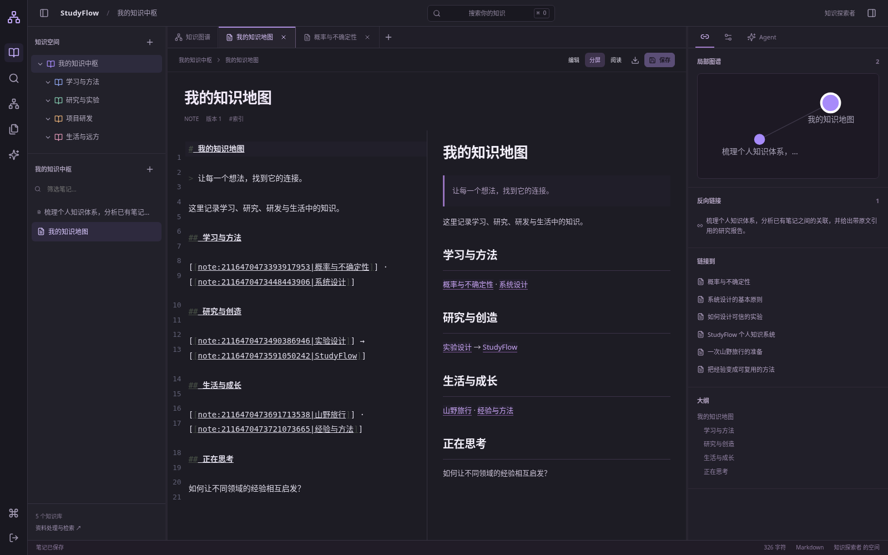
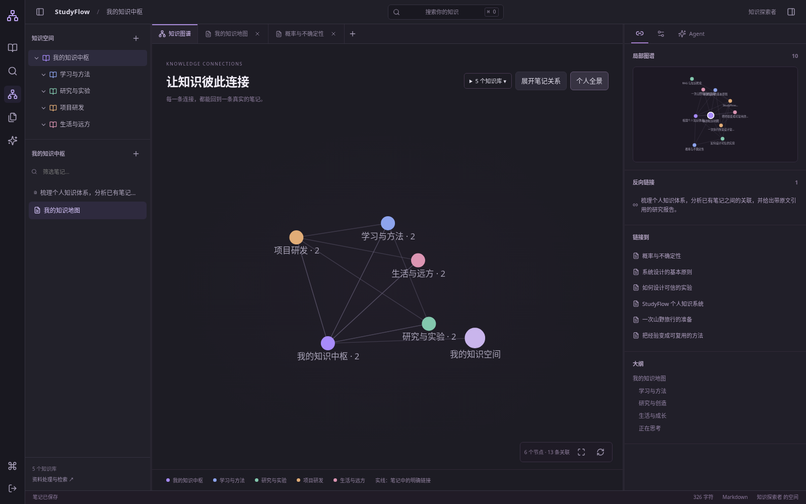
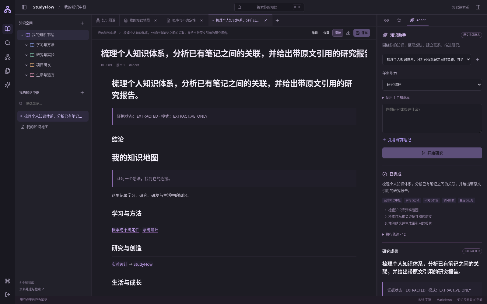
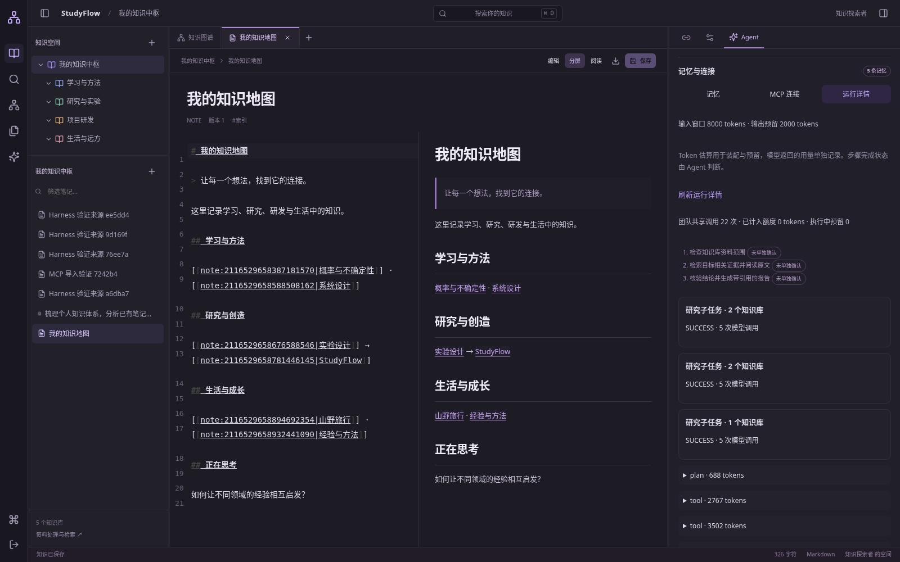
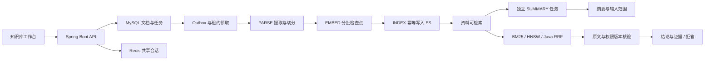

<div align="center">


# StudyFlow

**以个人知识为中心：自由扩展知识库，用双向链接连接想法，让 Agent 带着证据完成研究。**

[](https://github.com/wangbf123/StudyFlow/actions/workflows/quality.yml)
[](studyflow/pom.xml)
[](studyflow/pom.xml)
[](studyflow/docs/agent/personal-knowledge-architecture.md)
[](studyflow-web/package.json)
[](retrieval-lab/README.md)
[](retrieval-lab/model-lock.json)
[](studyflow/docs/harness-verification.md)

[界面预览](#界面预览) · [项目亮点](#项目亮点) · [链路与架构](#链路与架构) · [快速开始](#快速开始) · [验证结果](#验证结果) · [文档导航](#文档导航)

</div>

---

StudyFlow 是「可扩展知识库 + Agent」工作区。你可以自由组织学习、科研、研发、工作与生活领域，用 Markdown、双向链接、属性和版本记录沉淀知识；在局部图谱或个人全景中探索联系，再让 Agent 在选定知识库内检索、核验和生成报告。成果可以保存回笔记，继续进入知识网络。

[使用与启动](studyflow/docs/guides/personal-workspace.md) · [架构与一致性](studyflow/docs/agent/personal-knowledge-architecture.md) · [四层十二模块 Agent](studyflow/docs/agent/harness-architecture.md) · [实现范围](studyflow/docs/agent/implementation-plan.md) · [本地验证](studyflow/docs/harness-verification.md)

Agent 按四层十二模块组织：模型路由与 Claude 原生接入、Token 预算和结构化压缩、有来源版本的长期记忆、官方 MCP 连接、持久化任务与领域子 Agent 协作。运行面板可检查记忆、授权连接和上下文用量；协作调用共享预算，报告仍需统一核验。可选 Python 容器默认关闭。

## 30 秒了解 StudyFlow

先建立自己的领域知识库，用笔记和双向链接组织学习、研究与项目经验，再让 Agent 在选定范围内检索原文、分工研究并核对报告来源。

- **看效果**：[知识工作区](.github/assets/brain-workspace.png)、[个人图谱](.github/assets/brain-graph.png)、[Agent 协作详情](.github/assets/brain-harness.png)。
- **开始体验**：[最小启动命令](#快速开始)，默认原文摘录问答无需模型密钥；需要 MySQL、Redis、MinIO、Elasticsearch。
- **看实现**：[十二模块 Harness](studyflow/docs/agent/harness-architecture.md)、[引用与故障恢复文章](docs/articles/evidence-and-recovery.md)，以及 [检索实验入口](retrieval-lab/README.md)。

*A personal knowledge workspace with linked notes, scoped graphs, and a durable agent harness for memory, MCP and evidence-grounded research.*

## 界面预览

### 知识工作区

左侧是任意层级的知识库与笔记，中间支持编辑、阅读和分屏，右侧展示反向链接、局部图谱、属性与 Agent。



### 个人知识图谱

先查看领域聚合，再点击展开真实笔记；可选择单库、多库与个人全景，局部图谱只探索选定范围内的关系。



### Agent 与知识共用工作区

选择知识库、附加当前笔记、运行任务 Skill；计划、工具调用和报告有持久记录，成果可保存为带来源链接的笔记。



<details>
<summary>记忆、MCP 连接与领域子 Agent 的运行详情</summary>



图中使用原文摘录模式。每个子任务有独立状态，报告由主任务统一核验；模型用量为供应商报告值，压缩清单使用本地 Token 估算。

</details>

截图来自真实 API 和 Chromium，使用新建的公开演示内容。模型为 extractive mock，实际调用笔记、图谱、文档检索与证据工具。图谱当前表达明确链接和层级关系。[验证记录](studyflow/docs/personal-workspace-verification.md)列出范围与限制。

<details>
<summary><strong>保留的资料处理、混合检索和证据问答界面</strong></summary>


这些截图来自前一轮公开样例验证，原功能可通过工作区的“资料处理与检索”入口打开。

</details>

## 项目亮点

| 能力 | 关键技术 | 可以解释的工程问题 |
| :--- | :--- | :--- |
| **个人知识网络** | 任意知识库层级、稳定 Wiki 链接、属性与历史版本、G6 聚合与局部图谱 | 知识按领域组织，也能跨项目引用，重命名与移动保持链接 |
| **Agent 上下文与记忆** | O200K 估算、结构化压缩、结果按需读取、有来源版本与范围的长期记忆 | 控制上下文窗口，来源更新后停止召回旧知识 |
| **领域子 Agent 协作** | 持久化子任务、深度限制、根任务共享调用与 Token 预留、取消级联 | 并行工作不扩大权限，不各自花完整份预算 |
| **模型与 MCP 连接** | Claude 官方 SDK、OpenAI 兼容路由、官方 MCP Streamable HTTP SDK、Schema 校验 | 接入模型与外部资料，统一工具边界与调用审计 |
| **可恢复研究 Agent** | LangGraph4j、原生工具调用、检查点、租约、SSE 回放 | 页面断线与后台执行分离，旧执行者无法覆盖结果 |
| **有来源的知识沉淀** | 文档与笔记版本核验、报告幂等写回、来源链接 | 成果进入知识库，原文变化可追溯 |
| **图谱查询投影** | MySQL 事务 outbox、Neo4j、graph_revision、规范数据复查 | 旧投影不覆盖新关系，访问范围由服务端决定 |
| **可评测混合检索** | ES BM25 / HNSW、CPU BGE、固定 revision、Java RRF | 语义与关键词互补召回；用同一语料比较五种检索模式 |
| **结论与证据绑定** | 严格 JSON、来源白名单、连续引文、UTF-16 位置、独立核验请求 | 伪造引用拒绝发布；重建后的历史证据明确标记版本 |
| **可恢复文档流水线** | 事务 Outbox、分批检查点、心跳与租约 fencing、generation | 崩溃后复用已生成向量；旧 worker 无法覆盖新版本 |
| **独立摘要支线** | INDEX 完成后事务创建 SUMMARY、独立状态与输入预算 | 摘要失败不阻塞检索；截断范围在界面明确显示 |
| **知识库工作台** | 所有权聚合、当前版本统计、游标分页、任务视图 | 查看真实资料状态，避免文档逐条统计和深 OFFSET |
| **多实例运行与观测** | Redis 共享会话、Actuator、缓存 Prometheus 指标、请求追踪 | token 跨实例 / 应用重启可用；检查积压和运行状态 |
| **前端工程化** | 按需组件、同源 API、SSE 增量解析与取消、组件分离 | 支持反向代理部署；断流、中文边界和过期响应有明确行为 |

同时保留分片上传、PDFBox / PaddleOCR 分流、上下文预算、SSE 状态推送和证据问答。完整模块与接口说明见[详细项目指南](studyflow/docs/project-guide.md)。

## 链路与架构


*动图为资料与问答链路示意；问答验证结果见下方实测说明。*

<details>
<summary><strong>展开静态架构图</strong></summary>



</details>

## 快速开始

需要 **JDK 21、Maven 3.9+、Node.js 22+、Docker Compose**。以下 Bash 命令从仓库根目录执行。

新工作区、可选 Neo4j 和 Agent 操作见[个人知识工作区指南](studyflow/docs/guides/personal-workspace.md)。

### 后端与基础设施

```bash
cd studyflow
docker compose up -d mysql redis minio elasticsearch
STUDYFLOW_MQ_MODE=async STUDYFLOW_OCR_ENABLED=false mvn spring-boot:run
```

此模式使用本地异步执行器、mock AI 和 mock embedding，可体验 TXT / Markdown / 文本型 PDF 链路。mock 问答只输出原文摘录，并在页面标记；真实语义检索需配置 BGE。

### 前端

在另一个终端，从仓库根目录执行：

```bash
cd studyflow-web
npm ci
npm run dev
```

| 入口 | 地址 |
| :--- | :--- |
| 前端 | `http://localhost:5173` |
| API / Knife4j | `http://localhost:8080` / `http://localhost:8080/doc.html` |
| MinIO 控制台 | `http://localhost:9001` |
| Elasticsearch | `http://localhost:9200` |

真实 BGE 侧车、模型身份与新索引配置见[检索实验指南](retrieval-lab/README.md)。RocketMQ、PaddleOCR 和外部模型接入见[详细项目指南](studyflow/docs/project-guide.md)。

### 构建与验证

```bash
cd studyflow
mvn verify
```

```bash
cd studyflow-web
npm ci
npm run build
```

真实 MySQL / ES 测试使用隔离库和索引，启用方法见[完整验收记录](studyflow/docs/highlights-verification.md)。

## 验证结果

2026-10-31 四层十二模块 Agent 已完成 133 项后端测试和 13 项前端测试，协作、记忆、MCP、隔离执行、浏览器与重启验证见[最新报告](studyflow/docs/harness-verification.md)；知识工作区阶段记录见[工作区验证](studyflow/docs/personal-workspace-verification.md)。下方保留前一轮文档检索与证据核验实验的样本和结果。

**2026-10-15：开启真实 MySQL / ES 的 85 项后端测试全部通过，前端 8 项协议测试与生产构建通过。** 徽章记录本次实测，不代表持续集成状态。

| 实验 | 实测结果 |
| :--- | :--- |
| 24 份资料完整 API 链路 | 真实 MinIO、CPU BGE 与 ES 完成主流水线和独立摘要 |
| 共享会话 | 同 token 跨两个实例使用，应用 SIGKILL 后无需重新登录 |
| 工作台与权限 | 当前版本统计、无重复游标页、跨用户概览/任务访问拒绝 |
| 浏览器检查 | 概览、排名详情、引用高亮、文件筛选和 390px 手机布局 |
| Java API 检索对照 | 22 道 test 问题：BM25 Recall@5 0.8864；RRF 1.0000 |
| 引用与 SSE | 原文定位可核对；核验完成后才发送答案 delta |
| 重建、删除与跨用户访问 | 旧引用标记版本；删除及越权访问拦截 |
| 历史文档 SIGKILL 实验 | 2026-10-09 同任务约 66 秒恢复，45 个分片无重复；见保留报告 |

当前检索集由实现者编写并标注，规模较小；问答端到端为 **extractive mock**。这些数据不代表真实大模型准确率或生产容量。参数、逐题排名和复现步骤均保留在仓库。

<details>
<summary><strong>查看 Java API 检索样例指标</strong></summary>

| 模式 | Recall@5 | MRR@5 | nDCG@5 | 顺序查询 p95 |
| :--- | ---: | ---: | ---: | ---: |
| BM25 | 0.8864 | 0.8788 | 0.8688 | 34.51 ms |
| VECTOR | 0.9091 | 0.7652 | 0.8025 | 76.01 ms |
| RRF | 1.0000 | 0.8977 | 0.9238 | 89.73 ms |
| RRF_LEXICAL | 1.0000 | 0.9205 | 0.9406 | 88.51 ms |
| LEGACY | 0.8864 | 0.8788 | 0.8651 | 65.65 ms |

24 分片、22 道 test 问题，单进程顺序测量并预热，未测高并发。完整报告见[Java API 评测](retrieval-lab/reports/workspace-java-evaluation.md)。

</details>

## 知识库如何工作

### 资料与派生摘要各自推进

文档、任务和唤醒事件在 MySQL 事务内保存；文件读取、OCR、向量及模型请求在事务外执行。主任务只有完成 INDEX 才发布可检索状态，随后创建新的 SUMMARY 任务。摘要的失败、重试与租约回收不改变主索引状态。

向量生成每次只读取一批分片并保存检查点，重启后扫描同一 generation，复用模型和维度兼容的有效向量。索引通过稳定 ID 幂等写入。恢复扫描有批次上限，并与重建、删除保持统一锁顺序。

### 排名和引用都能核对

关键词与语义召回分别保留原始排名，Java RRF 按 `1 / (60 + rank)` 合并；过滤旧版本候选不会抬高剩余片段的排名。检索说明接口公开候选数量、原始排名、贡献及降级原因，分数不表示准确率。

问答结论绑定本次检索来源与连续引文，保存 generation、正文 SHA-256 和 UTF-16 位置。发布前后复查权限和版本，真实模型模式执行独立核验请求。历史引用在重建后标记旧版本，删除后引用详情不可读取。

### 工作台与运行状态有真实数据

知识概览只统计所属知识库的当前有效资料，资料列表采用游标分页。登录会话由 Redis 共享，操作端点返回请求 ID，Prometheus 抓取读取缓存快照。默认管理端口为 `127.0.0.1:9091`；详情见运行指南。

## 工程验证与复现

```bash
# 前端协议测试
cd studyflow-web
npm test
npm run build
```

真实 MySQL / ES 测试和双实例 API 验证有独立入口，避免测试清理应用数据。完整命令、隔离条件、验证范围及实际报告见[本轮升级验收](studyflow/docs/workspace-upgrade-verification.md)。

默认质量工作流运行后端单元验证、前端协议测试与生产构建；真实依赖工作流支持手动触发。工作流状态见页首实时徽章，静态测试数量记录本次本地实测。

## 文档导航

| 阅读目的 | 文档 |
| :--- | :--- |
| 使用个人知识工作区 | [笔记、双向链接与图谱](studyflow/docs/guides/personal-workspace.md) · [资料工作台](studyflow/docs/guides/knowledge-base.md) |
| 理解 Agent 的十二模块 | [Harness 架构与配置](studyflow/docs/agent/harness-architecture.md) · [实现范围](studyflow/docs/agent/implementation-plan.md) |
| 核对本轮实测 | [Harness 验证](studyflow/docs/harness-verification.md) · [协作 API](studyflow/docs/experiments/harness-agent-api.json) |
| 了解资料工作台技术选择 | [ADR：知识库工作台](studyflow/docs/adr/001-knowledge-workspace.md) · [当前架构](studyflow/docs/architecture-v2.md) |
| 调用新增接口 | [工作台与检索 API](studyflow/docs/guides/api.md) |
| 配置部署与监控 | [运行、监控及升级指南](studyflow/docs/guides/operations.md) |
| 核对最新实测 | [升级验收](studyflow/docs/workspace-upgrade-verification.md) · [API 报告](studyflow/docs/experiments/workspace-api-results.json) |
| 理解业务、模块与接口 | [详细指南](studyflow/docs/project-guide.md) · [技术架构](studyflow/docs/TECHNICAL_ARCHITECTURE.md) |
| 运行真实向量检索 | [BGE 侧车与五路评测](retrieval-lab/README.md) · [固定模型版本](retrieval-lab/model-lock.json) |
| 理解问答证据边界 | [结论与原文证据](studyflow/docs/claim-evidence-qa.md) |
| 理解故障恢复 | [持久任务设计](studyflow/docs/durable-document-pipeline.md) · [SIGKILL 实测](studyflow/docs/experiments/pipeline-process-recovery-results.json) |
| 核对质量与验收 | [Java API 检索报告](retrieval-lab/reports/workspace-java-evaluation.md) · [完整 API 结果](studyflow/docs/experiments/highlights-e2e-results.json) |
| 准备技术面试 | [亮点验收与简历表述](studyflow/docs/highlights-verification.md) · [Agent 执行与能力边界](studyflow/docs/LEARNING_AGENT.md) |

<details>
<summary><strong>实现边界与后续增强</strong></summary>

- 真实生成模型语义准确率、RocketMQ 集群故障与生产容量尚未验证。
- 摘要已独立，向量和索引已分批；PARSE 仍采用整文件 / 全部分片内存处理，流式解析有待继续实现。
- 共享对象保留策略、parser / chunker 完整版本缓存和索引 alias 灰度切换仍待建设。
- 应用会话已通过 Redis 共享；Redis 数据丢失、持久化与集群故障不在本轮应用重启验证范围。

</details>

---

同作者项目：[CampusTrade — 交易一致性与可靠通知](https://github.com/wangbf123/CampusTrade-Backend)
