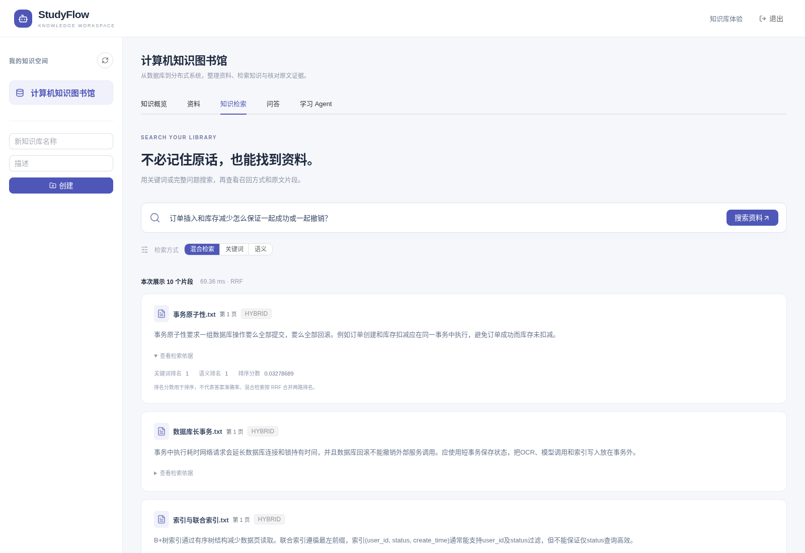

# Spring Boot RAG 知识库：如何约束伪造引用，并在任务崩溃后继续处理？

把 PDF 接到大模型上，通常很快能得到一个问答演示。让回答能回到原文、让文档处理在进程退出后恢复，则需要把证据与任务状态作为独立的工程问题处理。

[StudyFlow](https://github.com/wangbf123/StudyFlow) 使用 Spring Boot、Vue 和 Elasticsearch 实现个人资料知识库。本文讨论两个可以复核的设计：结论与原文绑定，以及持久任务的检查点恢复。

## 使用者真正需要什么

复习课程笔记时，读者需要看到答案来自哪份资料、哪一段原文。查不到证据时应明确拒答；文档重建后，旧答案也不应高亮到新的文本上。对于长文档，用户则希望服务重启后继续处理，而不是反复上传。



该截图来自仓库已有的真实浏览器验证，使用公开样例、真实 MinIO／BGE／ES。问答生成器是 extractive mock，截图不构成真实生成模型的准确率证明。

## 先约束来源，再检查结论

StudyFlow 的生成协议要求严格 JSON，每条 claim 包含检索来源与连续引文。确定性校验先完成以下检查：

1. `source_id` 必须属于本次检索返回的来源白名单。
2. `quote` 必须是该分片中的连续原文，不能只返回一个“看起来正确”的文档 ID。
3. 引用保存 generation、正文 SHA-256 和 UTF-16 起止位置，供浏览器准确定位。
4. 核验前后重新检查所有权、文档状态和版本，避免删除、重建和问答并发时发布失效证据。

这能约束伪造来源和错位引文，但原文中存在一段文字，并不能证明模型概括必然成立。真实模型路径还会发起独立核验请求；格式错误、超时、矛盾和证据不足都不放行答案。核验模型仍可能误判，因此这里的工程承诺是“发布前执行检查”，不能写成“消除了幻觉”。

SSE 先发送核验状态，通过检查后才发送可见答案。历史引文在重建后标记 `STALE_VERSION`，删除文档后不再提供引用详情。实现与受控模型响应测试见 [证据协议](../../studyflow/docs/claim-evidence-qa.md)。

## 让恢复成为持久协议

主链路分为 PARSE、EMBED、INDEX；只有当前 generation 完成 INDEX 才可检索。SUMMARY 是后续独立支线，其失败不会让已完成索引的资料退回不可检索状态。

数据库保存文档、任务和唤醒事件。worker 通过租约领取任务，批量写入向量并保存检查点。进程崩溃后，恢复扫描重新发现任务；兼容模型和维度的已完成批次可以复用。写入还要检查 generation 和领取身份，防止旧 worker 在新任务开始后覆盖结果。

外部 OCR、模型与存储请求放在事务外，任务与派生状态通过短事务推进。具体边界、批次限制和仍待改进的整文解析问题，见 [持久任务设计](../../studyflow/docs/durable-document-pipeline.md)。

## 怎样验证，哪些结论不能下

从仓库根目录执行：

```bash
cd studyflow
mvn verify
# 另一个终端从仓库根目录执行
cd studyflow-web
npm ci
npm test
npm run build
```

默认 Java 测试会跳过需显式开启的 MySQL／ES 集成项，不能据此声称真实基础设施全部通过。2026-10-26 的云环境默认后端检查执行 60 项、跳过 25 项，前端 8 项协议测试与构建通过；MinIO 的网络依赖尚未解决，没有在当前实例重验文件上传与问答全链路。

仓库保留的历史验收包含真实 MySQL／Redis／MinIO／BGE／ES 链路、权限与版本竞争、恢复实验和小规模检索评测。引用这些历史数据时应同时链接 [原验收条件](../../studyflow/docs/workspace-upgrade-verification.md)，并保留日期、样本规模与 extractive mock 边界。它们不能外推成真实生成模型准确率、生产 QPS 或集群可用性。

## 从哪里开始复用

如果只关心 RAG 引用，可以先读 `EvidenceAnswerSecurityTest` 和证据协议；如果关心 worker 恢复，先读任务租约、检查点与 generation 的状态转换。两部分都应连同失败测试一起研究。前者依赖权限与文档版本，后者依赖持久状态，直接复制一个工具类通常不足以保留完整保证。

项目与源码：[wangbf123/StudyFlow](https://github.com/wangbf123/StudyFlow)。完整启动命令与真实截图见 [项目首页](../../README.md)。
