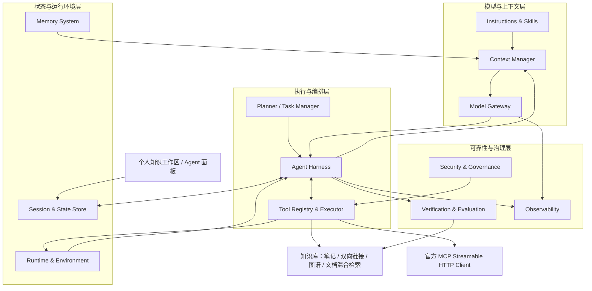
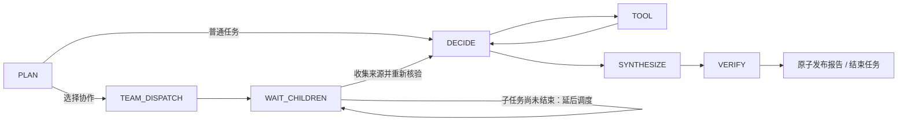

# StudyFlow Agent Harness：四层、十二模块

更新：2026-10-31。保留个人知识库、Markdown、双向链接、知识图谱和原有混合检索，将 Agent 的职责拆成独立组件。本分支同时包含后端、界面、数据库迁移、配置示例和验证材料。

这是一套面向个人知识工作的持久化 Agent：由明确选择的领域范围进入资料，借助工具推进任务，核验后发布报告，再以带来源的笔记和执行记忆回到知识空间。

## 1. 模块和代码边界

| 层次 | 模块 | 主要实现 | 已实现的边界 |
|---|---|---|---|
| 模型与上下文 | Model Gateway | `agent/model/ModelGateway` | 按阶段路由；OpenAI 兼容协议、Claude 原生 Messages；并发槽、有限重试、短时熔断；每次尝试计入预算 |
| | Instructions & Skills | `agent/skills/SkillCatalog` | 有版本的研究、对比、复习、整理、代码研究角色与工具集；权限由服务端范围控制 |
| | Context Manager | `agent/context/ContextManager` | Token 估算、工具描述预算、按范围召回记忆、近期历史、结构化压缩、结果引用、调用清单 |
| 执行与编排 | Agent Loop / Harness | `agent/loop/AgentHarness`, `AgentGraph` | LangGraph4j 条件路由，节点输出检查；执行循环不持有 HTTP 连接 |
| | Planner / Task Manager | `agent/planning` | 持久化步骤和前置依赖；依工具依据确认步骤；协调者分区、子任务分派与汇总 |
| | Tool Registry & Executor | `agent/tools` | 按 Skill/范围筛选、JSON Schema 校验、本地工具、官方 MCP SDK、结果分页读取 |
| 状态与运行环境 | Session & State Store | `agent/state/AgentStateStore` | 幂等创建、节点检查点、数据库租约与 fencing、有序事件、报告原子发布 |
| | Memory System | `agent/memory/MemorySystem` | 偏好/知识/经历/方法记忆；来源版本、过期、跨会话召回、主动忘记 |
| | Runtime & Environment | `agent/runtime` | 有界调度池、节点超时与恢复；可选无网络临时 Python 容器 |
| 可靠性与治理 | Security & Governance | `agent/governance/AgentPolicy` | 用户所有权、明确范围、子任务范围不能扩大、远程连接白名单 |
| | Verification & Evaluation | `agent/verification`, `rag/EvidenceAnswerService` | 引用与原文匹配、独立模型核验、发布前版本复核、确定性运行检查 |
| | Observability | `agent/observability/HarnessTelemetry` | OpenTelemetry Span、可选 OTLP、Micrometer、模型调用审计与上下文预算清单 |



Session 保存一场任务运行到哪里；Memory 保存未来可复用的内容。Harness 选择下一步；Runtime 调度节点并管理生命周期；Environment 执行获准的操作。RAG 问答不需要代码 Sandbox。

## 2. 上下文装配与压缩

每次请求都经过统一 Token 检查，包含系统指令、序列化后的用户数据、工具 Schema 和消息开销预留。默认输入 8,000、输出上限 2,000 tokens。

1. 固定任务目标、选定知识库、计划和当前笔记引用，不能因压缩而截断。
2. 按角色选择工具；工具描述使用独立预算，优先保留结束研究和结果读取能力。
3. 从已选范围召回仍有效的记忆；跨域记忆的完整来源范围必须是本次范围的子集。
4. 放入近期会话；为每个工具结果保留编号、工具名、状态、摘要和稳定 `tool-result:run:step` 引用。
5. 近期结果给较多正文预算，旧结果保留少量摘录；超限时移除正文、历史和记忆，固定约束仍保留。
6. 完整的有界工具结果保存在数据库；模型可通过 `read_tool_result` 分页取回当前任务的结果。

这是**结构化的确定性压缩**，不会生成未经核验的事实摘要。工具结果最大默认 64,000 字符，不承诺无限存储。清单记录估算量、预算、压缩结果数、记忆 ID、工具名和来源数量；不记录原始 Prompt 或模型私有推理。

jtokkit 的 O200K 编码用于统一估算；Claude、DeepSeek 以及其他模型的实际分词可能不同。供应商报告的 input/output tokens 另行记录，不能把预算估算当成实际账单。

## 3. 记忆与知识库连接

| 类型 | 内容与来源 | 默认有效期 |
|---|---|---|
| PREFERENCE | 用户明确保存的学习/输出偏好 | 365 天，可配置 |
| SEMANTIC | 用户提炼的知识，必须关联当前范围内笔记版本 | 365 天，可配置 |
| PROCEDURAL | 有笔记依据的方法、操作经验 | 365 天，可配置 |
| EPISODIC | 根任务自动保存目标、结果状态、成功工具和运行 ID | 90 天 |

当前采用作用域过滤、词项匹配和时间排序；每种类型保留近期最多 25 条候选，总计最多 100 条。召回时优先预留 1 个偏好位置、2 个知识/方法位置，再填充其他相关记忆，避免大量相似经历挤掉知识和偏好；不是向量语义记忆。自动经历只记执行事实，不自动把模型回答提升为个人知识。笔记修改、移动、删除，知识库归档或记忆到期，都会阻止相关知识记忆召回。管理界面可检查失效记忆并主动忘记。

领域是可扩展的知识库树，不内置“学校/公司/投资”等固定权限枚举。父子层级用于组织；本次任务选中的知识库决定可见范围。跨域互动依赖明确链接和用户选择。

- 笔记：`search_notes`、`read_note`，携带当前 revision 和内容 hash。
- 图谱：`explore_graph`，只导航所选范围内的显式关系；图关系不能代替事实证据。
- 文档：复用 Elasticsearch BM25 + BGE 向量 + RRF 与来源代次检查。
- 输出：报告统一核验，保存为笔记后形成稳定来源链接。

## 4. 持久化执行和多 Agent



协作采用**协调者 + 独立研究子任务**。最多 3 个子任务、深度 1；所选领域被分成互不扩大的子范围。子任务有各自 session、run、checkpoint 和结果；协调者等待时不占用执行线程。研究结果进入父任务后，仍通过父任务的来源刷新和统一核验。

数据库是状态权威，LangGraph4j 负责拓扑和恢复 API，不再引入第二份独立 checkpoint 权威。一个节点的状态、工具结果、计划状态、事件和报告在同一事务提交。租约失效的旧 worker 不能发布结果。

- 所有模型尝试先原子预留共享根任务的调用数及“估算输入 + 输出上限”。
- 已报告用量替换对应预留；未知用量保守计入已预留额度，并标记 `usageIncomplete`；根任务汇总子任务的用量不完整状态。
- 根任务行先加锁，预算检查使用当前加锁读取，防止 MySQL Repeatable Read 的旧快照造成超额放行。
- 根任务取消/终止会级联取消子任务；子任务截止时间不晚于根任务；重试保留原协作模式并创建新预算。
- 普通任务默认 16 次调用、40,000 tokens；协作根任务提高至最多 40 次、120,000 tokens，子任务共享这份额度。
- 计划状态 `AGENT_COMPLETED` 需要成功工具观察和已完成的前置步骤；不声称步骤内容已经独立判分。

恢复保证是**检查点恢复与发布隔离**。进程在外部调用完成、提交之前崩溃时，外部读取或计算可能重试；没有宣称跨供应商 exactly-once。取消立即阻止后续提交，已发出的供应商请求能否立刻停止取决于协议和客户端。

## 5. MCP 连接

复用官方 Java SDK 2.1.0，支持 Streamable HTTP 初始化、工具分页发现、工具调用、资源浏览和文本资源导入；使用与现有 Spring/Jackson 2 应用兼容的 `mcp-json-jackson2` 模块。

管理员配置精确地址、只读工具名和资源 URI 前缀，用户再把连接绑定到自己的知识库范围。模型和用户 API 无法提供新的服务器地址、Shell 命令或凭据。

工具发现缓存 30 秒，短暂故障退避 15 秒，发现阶段设总时间预算，避免远程服务故障阻塞本地知识工具。连接使用每用户独立的 MCP client；有并发缓存上限、连接/请求超时、分页/工具数/响应大小限制；HTTP 重定向关闭。调用前重新检查绑定与范围，不能借连接跨到未选知识域。工具的输入 Schema 受深度和引用限制，外部 `$ref` 不会被加载。

MCP 返回值始终视为外部数据。直接工具输出不获得“可信证据”身份；文本资源经过明确导入，保存连接名、URI 和 hash 后，才能沿笔记核验链引用。工具白名单由管理员对服务实际行为负责，不能仅凭服务器的 `readOnlyHint` 判断安全。

当前没有启用 stdio、任意命令启动、MCP Sampling、Elicitation 或实验性 Tasks，也没有把整个 StudyFlow 伪装成已完成的 MCP Server。

## 6. 可选代码环境

`coding` Skill 在部署启用后获得 `run_python`。容器使用 digest 固定镜像，禁止临时拉取；运行前需预加载镜像。

执行参数包括：无网络、无宿主机目录/Socket 挂载、只读根目录、65534 用户、移除 capabilities、禁止提权、PID/CPU/内存限制、临时 `/tmp`。执行最多 20 秒，输出最多 64 KB，结束或失败后清理容器。

默认关闭，不要求普通知识 Agent 具有 Docker 权限。这是容器隔离能力，不宣称等同于微虚拟机或可安全执行所有恶意程序；提供 Docker daemon 访问权的部署实例应按受信任基础设施管理。

## 7. 验证与可观测性

发布检查沿用同一套 RAG 核验：声明结构与原文摘录匹配 → 当前来源权限/版本 → 可选独立模型核验 → 发布事务中再次复核。Mock 模式明确标为 `EXTRACTIVE_ONLY`。

`/runs/{id}/evaluation` 提供任务结束、子范围、共享预算、报告证据当前性等确定性检查；语义完整性标记 `NOT_INDEPENDENTLY_SCORED`，不提供虚构的“正确率”。

模型调用记录 route、purpose、模型、状态、耗时、用量和 Trace ID。OpenTelemetry Span 带 run/root/role 属性，可导出到 OTLP gRPC Collector；Micrometer 保留运行与用量指标。每次调用有独立 Span，通过 run/root 属性关联，不宣称已实现跨进程的完整父子 Trace 树。

## 8. 技术选型与版本依据

| 技术 | 版本 | 选择理由 |
|---|---|---|
| Java / Spring Boot | 21 / 3.3.7 | 保留现有工程兼容性与验证范围；本轮不顺带迁移整个框架 |
| LangGraph4j | 1.9.7 | 复用现有稳定条件图和恢复机制 |
| MCP Java SDK | 2.1.0 | 检索日稳定版本；2.2.0-M1 是预览版，没有采用 |
| Anthropic Java SDK | 3.3.0 | 原生 Messages/Tool Use，SDK 重试关闭，由网关统一记账 |
| jtokkit | 1.1.0 | Java 本地 Token 估算，避免按字符数冒充 Token |
| networknt JSON Schema | 2.0.8 | Jackson 2 兼容线；3.x 需要 Jackson 3，不强塞入现有应用 |
| Jackson BOM | 2.22.1 | 对齐 Schema 校验器依赖，完整回归现有 JSON 路径 |
| OkHttp / Kotlin runtime | 5.5.0 / 2.1.21 | 对齐 OTel 与 Claude SDK 的 HTTP 依赖，避免同时打包 4.x/5.x 的同名类 |
| OpenTelemetry | 1.67.0 | API/SDK/Exporter 用同一 BOM 对齐，避免 Spring 旧 BOM 混用 |

来源（2026-10-31 核对）：[LangGraph4j](https://github.com/langgraph4j/langgraph4j)、[MCP Java SDK v2.1.0](https://github.com/modelcontextprotocol/java-sdk/tree/v2.1.0)、[MCP 2025-11-25](https://modelcontextprotocol.io/specification/2025-11-25)、[Anthropic Java](https://github.com/anthropics/anthropic-sdk-java)、[jtokkit](https://github.com/knuddelsgmbh/jtokkit)、[networknt](https://github.com/networknt/json-schema-validator)、[OpenTelemetry Java](https://github.com/open-telemetry/opentelemetry-java)。

参考 [LangChain context engineering](https://docs.langchain.com/oss/python/langchain/context-engineering) 和 [OpenAI 多 Agent 编排说明](https://openai.github.io/openai-agents-python/multi_agent/) 的职责分离思路，没有直接嵌入互不兼容的 Python/Coding Agent 产品。用户提供的项目列表只作为方向参考，没有把未核实的 Star 或性能宣称当成选型依据。

## 9. 部署配置

默认配置可以继续使用 Mock、本地知识工具和 MySQL 持久化，不需要额外模型、MCP、OTLP 或 Sandbox 服务。

模型与 MCP 示例放入部署环境自己的 `application-local.yml`，文件已被 gitignore 排除。模型名和密钥由部署环境提供，不在仓库中填写真实值：

```yaml
studyflow:
  harness:
    input-tokens: 8000
    output-tokens: 2000
    routing:
      plan: general
      tool: general
      synthesize: general
      verify: verifier
    models:
      general:
        provider: openai-compatible
        base-url: https://api.openai.com/v1
        model: ${AGENT_GENERAL_MODEL}
        api-key-env: OPENAI_API_KEY
        max-concurrency: 2
        max-attempts: 2
        timeout-seconds: 25
      verifier:
        provider: anthropic
        base-url: https://api.anthropic.com
        model: ${AGENT_VERIFIER_MODEL}
        api-key-env: ANTHROPIC_API_KEY
        max-concurrency: 2
        max-attempts: 1
        timeout-seconds: 25
    mcp:
      references:
        enabled: true
        url: https://your-admin-approved-host.example/mcp
        token-env: REFERENCE_MCP_TOKEN
        tools: [search, read_reference]
        resource-prefixes: ['reference://library/']
        timeout-seconds: 10
    # Optional; use a real digest from your trusted image registry.
    sandbox-enabled: false
    sandbox-image: ''
    otlp-endpoint: ''
```

DeepSeek 使用独立 `openai-compatible` 路由与其官方 base URL/模型名即可；网关不从用户请求中接受 provider、URL 或 API key。阶段路由覆盖 plan/tool/synthesize/verify。当前 OpenAI 路由使用 Chat Completions，需要选择支持该协议、Function Calling 和 `max_tokens` 的模型。

## 10. API 与验证

新增管理 API 全部沿用登录与用户所有权检查：

| API | 用途 |
|---|---|
| `GET /api/agent/architecture` | 四层模块、Skill、脱敏模型目录和运行能力 |
| `GET/POST /api/agent/memories` | 检查当前范围的记忆、保存偏好或有出处的知识 |
| `DELETE /api/agent/memories/{id}` | 主动忘记 |
| `GET /api/agent/connections` | 用户连接目录与绑定范围 |
| `PUT /api/agent/connections/{key}` | 授权/撤销配置好的连接 |
| `GET /api/agent/connections/{key}/resources` | 浏览外部资源 |
| `POST /api/agent/connections/{key}/import` | 显式导入文本到授权知识库 |
| `GET /api/agent/runs/{id}/diagnostics` | 计划、子任务、上下文清单、模型调用、共享预算 |
| `GET /api/agent/runs/{id}/evaluation` | 确定性运行与证据检查 |

创建任务增加 `collaboration: true` 开启协作，默认关闭。原有创建、会话、取消、重试、SSE 和成果 API 保持兼容。

验证记录见 [Harness 验证报告](../harness-verification.md)。后续可扩展混合向量记忆、受审核的关系抽取、按需发现更多 MCP 工具，以及跨进程 Trace 传播；这些能力没有标记为已完成。
