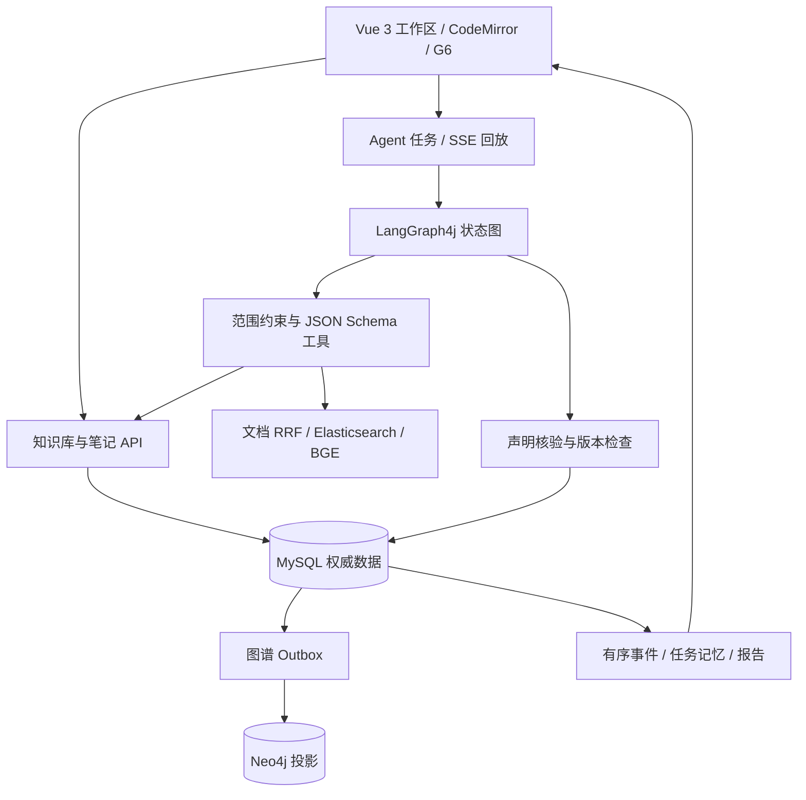

# 个人知识工作区与 Agent 架构

Agent 执行内核已进一步拆分为 [四层十二模块 Harness](harness-architecture.md)，包括长期记忆、Token 上下文、MCP、领域子任务、共享预算和可选运行环境。本文侧重知识库与图谱的数据一致性。

## 内容与链接

`knowledge_base` 通过可选 parent_id 表达任意领域层级。修改树结构时按用户行串行化，检查循环及 12 层上限；有子知识库的目录需先移动子项后删除。层级变更不会改变笔记归属。

`knowledge_note` 保存正文、类型、标签、属性和 revision；同一知识库内活动标题规范化后唯一。更新必须携带当前 revision，冲突保留客户端草稿。笔记移动使用单独的版本化接口，稳定 ID 不变。

`knowledge_note_link` 保存源笔记、目标 ID、原始链接文本、别名、标题/块锚点和源版本。解析忽略围栏与行内代码。标题简写只在当前知识库解析；跨库使用明确 ID 或库地址。未解析链接保留为待创建状态；同库目标出现后自动解析。普通编辑保留已经绑定的目标，避免重命名造成断链。

`knowledge_note_revision` 保存提交快照，历史内容载入编辑器后需再次保存才形成新版本。原始文档继续走现有对象存储和可恢复处理流程。

## 图谱投影

笔记、链接与 outbox 在同一 MySQL 事务提交。投影器使用 claim token 和租约领取消息，失败后退避。每条笔记有独立 graph_revision；解析待创建链接也会递增该版本。

Neo4j 写入先获取节点写锁，再以 graph_revision 隔离旧更新，避免晚到消息覆盖新关系；关系重建在同一个 Neo4j 事务完成。初始化唯一约束使用 Driver 的 managed transaction，处理多实例同时启动的瞬时冲突。

图查询固定为服务端 Cypher，限定 owner、知识库及最多两跳。最终节点、关系与权限仍以 MySQL 为准；投影落后或不可用时采用有界规范数据结果。单次全图最多展示 300 条笔记，关系读取最多 3000 条，局部图最多约 100 个节点并标明截断。

个人全景是前端对真实知识库与笔记关系的聚合视图，支持展开库节点。跨域边来自已有明确链接，没有把相似名称或模型推测直接视为事实。

## Agent 状态与事务

每个 run 保存：主知识库、选定知识库 ID、Skill、可选当前笔记、计划、观察结果、来源快照、草稿、调用预算及下一节点。创建请求以用户与 request_key 幂等，并比较请求指纹。

图节点执行在远程事务外；每次模型调用先预占调用额度。节点结果提交时检查 status、token、lease、deadline 及全部运行范围。状态、事件、检查点原子提交；最终报告与完成事件也同事务发布。过期执行者不能写回。

宕机前未提交的模型或只读工具请求可能重放，费用也可能重复；已提交状态和发布结果受到租约隔离。取消立即终止可提交资格，已发出的远程请求不保证立即停止。

任务执行使用独立有界工作池；调度线程池与图投影连接/事务重试均有上限。SSE 只订阅数据库中的已提交事件，按 seq 回放，连接断开不取消任务。

## 证据与记忆

文档来源保存 chunk、generation 与内容哈希；笔记来源保存稳定 ID、revision、全文哈希与本次提供的原文片段。两类来源共用原文引用 schema 和语义核验服务，通过各自的权限/版本访问器验证。

Mock 只接受与引用完全一致的摘录，标明 EXTRACTIVE_ONLY。真实 provider 使用第二次有限核验请求，服务不可用时不发布未经核验结论。发布事务在来源行共享锁下再次检查；后续资料变更会令历史报告 evidenceCurrent=false。

同一会话的成功历史仅在原使用范围是本次范围子集时进入上下文。历史是理解任务的资料，事实仍需本轮重新检索、核验。保存报告为笔记会生成稳定来源链接，使成果能够在后续任务中再次被查找。
