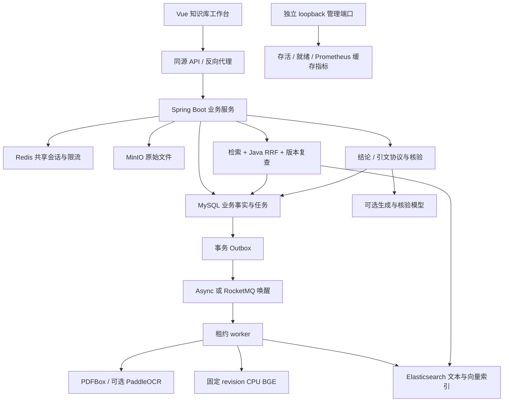
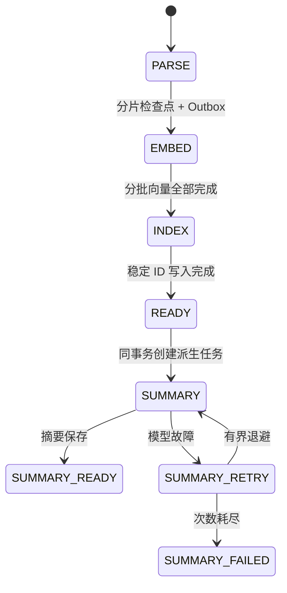
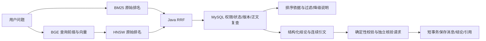

# StudyFlow 知识库架构 · 2026-10

## 系统边界



MySQL 决定文档归属、当前 generation、任务状态及已保存的结论/证据；ES 是可重建投影，Redis 提供共享会话与限流，MQ 是唤醒通道。数据读取与消息发送不依赖分布式事务。

## 文档主流水线与摘要支线



主任务是一条 `parse_task` 记录，在 PARSE / EMBED / INDEX 间推进；索引完成后该任务 SUCCESS。SUMMARY 使用新的任务记录，文档同时保存 `parse_status` 和 `summary_status`，二者互不混淆。

- 每次领取生成 claim_token，使用数据库时间计算租约；心跳持续续租。
- 每次检查点都核验 token、租约、任务阶段、generation 与知识库状态。
- EMBED 分页加载分片，单批远程计算后用短事务保存；部分批次已经成功时可复用有效同模型向量。
- INDEX 分页写稳定 `_id=document:generation:chunkIndex`；重复执行覆盖同一版本，不追加重复索引。
- async 模式 SUMMARY 使用独立有界线程池，主解析 worker 不承担摘要模型等待；队列拒绝传播回持久投递器，不能静默丢任务。RocketMQ 仍共享既有任务 topic，未验证独立消费者配额。
- SUMMARY 从有界分片页构建输入，保存实际字符数和截断标记。它的失败不会降低已就绪文档的可检索状态。
- 重建增加 generation；删除写 tombstone 并创建 CLEANUP。退役版本对账反复清理迟到索引写入。

解析仍读取整文件并构建全部分片，当前批次优化主要覆盖向量与索引阶段；超大文件流式解析是后续工作。

## 检索与证据



实现中先过滤无效候选，再按**保留的原始排名**计算融合贡献；其他无效候选被去除不会改变幸存片段的原始 rank。召回后复查正文内容，防止同 generation 的投影内容漂移。RRF_LEXICAL 另行加入词面覆盖排序，LEGACY 用于历史对照。

引用保存 UTF-16 字符位置、正文 SHA-256、文档 generation 和原文 quote。保存时按“文档 → 知识库 → 分片”持有共享锁，和重建/删除形成一致的事务边界。SSE 只发送已通过发布门槛的答案；真实核验模型并不等于人工事实判断。

## 模块组织

```text
studyflow/src/main/java/com/studyflow/
├── workspace/       知识库聚合、资料游标与任务视图
├── document/        文档、分片、重建、tombstone、解析器
├── task/            持久阶段、派生摘要、租约与 Outbox
├── search/          ES mapping、检索、RRF 与解释响应
├── rag/             上下文、结论/引文协议与核验
├── qa/              会话、事务保存与引用读取
├── embedding/       mock / BGE / OpenAI-compatible
├── observability/   缓存流水线指标
├── auth/、config/   Redis 会话、限流、请求 ID 与异步上下文
└── agent/           受限只读学习 Agent

studyflow-web/src/
├── components/      KnowledgeOverview、SearchWorkbench
├── lib/sse.js       增量帧解析、大小上限、取消与终止检查
├── api.js           同源 API 与统一流式调用
├── knowledge.css    知识库视觉与响应式布局
└── App.vue          资料、问答、Agent 与页面协调
```

## 可用性与可观测性

应用 token 通过 Redis 共享，在不同实例和应用重启后继续验证。缓存指标采用固定 stage/status 标签，抓取路径不查询 MySQL。业务异常保留兼容 code 格式，未知异常返回通用信息并通过请求 ID 定位日志。

健康端点区分存活与依赖就绪，管理端口默认 loopback。Redis HA、RocketMQ 集群故障、物理对象回收和生产容量未在这轮证明；部署策略及限制见[运行指南](guides/operations.md)。
