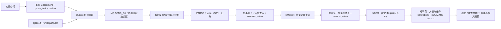

# 可恢复文档流水线

文档处理采用 MySQL 持久任务、阶段检查点和事务内 Outbox。RocketMQ 和本地线程池都只承担唤醒；数据库决定任务是否可执行。因此 broker 中断、本地进程重启、消息重复以及领取后崩溃不需要重新上传文件。



## 正确性边界

- 外部对象读取、OCR、模型请求和 ES 写入不持有数据库长事务。阶段结果与下一阶段 Outbox 在同一短事务提交。
- 领取任务使用数据库时间和条件更新；同一阶段只有一个有效 `claim_token`。后台每个租约的三分之一周期续租。检查点提交前核验 token、租约、阶段、文档 generation 和知识库状态。
- 按阶段保存 `PARSE → EMBED → INDEX`。失败从当前阶段重试，不重跑已经提交的阶段；自动重试有次数上限和指数退避，手动重试同样通过 CAS 并补写 Outbox。
- Outbox 发送必须获得 RocketMQ `SEND_OK`；发送确认丢失可以重复投递。async 模式中，线程池接受后尚未执行就重启的任务由数据库扫描补唤醒。
- 文档重建增加 `generation`，固定当前任务的 embedding 模型与维度。模型配置改变后旧任务拒绝复用，需要创建新 generation。分片唯一键 `(document_id,generation,chunk_index)`，ES 使用相同版本的稳定 ID。
- 文档删除首先持久化 tombstone 并取消未完成任务，再创建可重试 `CLEANUP` 任务。检索必须复查 MySQL 当前 generation、SUCCESS、所有者和知识库 ACTIVE，避免读取已删除或旧版本索引。
- 失去 token 不允许删除同 generation 的 ES 数据，因为新 worker 可能已经发布。后台定期扫描已退役 generation，重复幂等删除，补偿删除/重建之后的迟到写入。ES 不与 MySQL共享事务；版本过滤与持续对账提供最终一致。
- 同一所有者的重复上传可复用不可变对象，但每个文档有独立任务。对象可能被多个文档共享，因此此版本不直接删除对象；对象保留策略需按引用计数实现。

## API

- `GET /api/tasks/{taskId}` 返回原有状态及 `stage`、`generation`、`nextAttemptTime`。
- `POST /api/tasks/{taskId}/retry` 重试仍有效的当前 generation 失败任务。
- `POST /api/documents/{documentId}/rebuild` 创建下一 generation 的 PARSE 任务；重建期间旧版本隐藏。
- `DELETE /api/documents/{documentId}` 创建持久删除检查点及 CLEANUP 任务。

以上接口均要求登录和资源所有权。引用快照可保留历史信息，但旧 generation 不参与当前检索。

## 配置

| 配置 | 默认 | 用途 |
|---|---:|---|
| `studyflow.pipeline.lease-seconds` | 60 | worker / dispatcher 租约，最小 15 秒 |
| `studyflow.pipeline.scheduler-delay-ms` | 1000 | 补扫和投递间隔 |
| `studyflow.pipeline.batch-size` | 20 | 每轮恢复、领取与索引对账批次，范围 1–100 |
| `studyflow.pipeline.chunk-batch-size` | 64 | 向量 / 索引分页上限，范围 1–100 |
| `studyflow.pipeline.summary-max-chars` | 12000 | 独立摘要输入预算，截断会记录 |
| `studyflow.pipeline.max-retry-delay-seconds` | 300 | 重试退避上限 |
| `studyflow.pipeline.index-reconcile-delay-ms` | 30000 | 退役索引重复对账间隔 |

新增 V1 核心表采用 `CREATE TABLE IF NOT EXISTS`，配合 Flyway `out-of-order: true`，支持空数据库直接启动和已经执行 V3–V7 的 Docker 初始化数据库升级；不修改既有迁移文件。

## 验证

默认测试无需外部依赖：

```bash
mvn -Dtest=DocumentPipelineTest test
```

真实 InnoDB 故障协议和迁移演练要求预先创建独立测试数据库并授权。`PipelineStoreMySqlTest` 会重置 `*_test` 数据库中的测试表；迁移演练会清空专用 `*_upgrade_test` 数据库。URL 校验拒绝应用数据库。默认使用本地 `studyflow_pipeline_test` / `studyflow_pipeline_upgrade_test`，可用 `pipeline.test.jdbc-url` / `pipeline.upgrade.test.jdbc-url` 覆盖；密码通过环境变量 `PIPELINE_TEST_DB_PASSWORD` 注入。

```bash
mvn -Dpipeline.mysql.tests=true \
  -Dtest=DocumentPipelineTest,PipelineStoreMySqlTest,PipelineSchemaMigrationMySqlTest test
```

故障实验覆盖：24 个并发请求竞争一次领取、worker 租约失效及旧 token 写入、阶段事务回滚、线程池唤醒丢失、broker 发送失败及迟到确认、文档重建/删除的迟到结果、重试次数耗尽、仅清理已退役索引，以及历史 V7 数据库升级并保留原记录。

领取回归测试使用生产 MyBatis mapper，检查事务内先读取任务再通过 JDBC 领取时，返回对象包含新 token。JDBC 更新不会清除 MyBatis 的事务内查询缓存，因此领取后的读取使用 token 条件查询，防止拿到领取前的对象而无法提交检查点。

真实 API 验证结果保存在 `experiments/highlights-e2e-results.json`；实际子进程中断恢复结果保存在 `experiments/pipeline-process-recovery-results.json`。前者包括真实 MinIO 文件读取、BGE 生成与 ES 索引；后者使用独立 Java 进程 SIGKILL 后重新启动，验证同一持久任务无需重新上传即可完成。MQ 使用 async 执行器，不能据此声称已测 RocketMQ 集群恢复。

2026-10-15 起摘要为独立 SUMMARY 任务，INDEX 完成即可检索；摘要失败不改变主索引状态。EMBED 采用分批检查点并复用已完成向量，INDEX 分页幂等写入。PARSE 仍采用整文件与全部分片内存处理，流式解析、完整 parser/chunker 版本缓存和 alias 灰度切换尚未实现。

复现进程故障时在独立实例上传测试文档，轮询任务至 PROCESSING，对该 Java 进程发送 SIGKILL，然后使用相同数据库、索引和模型配置重新启动。保持数据库及对象存储不变，重新登录后轮询原 taskId；租约回收后应进入 SUCCESS，分片编号无重复并可检索。上述为 2026-10-09 的历史实验，当时使用进程内会话；2026-10-15 已接入 Redis 共享会话，新实验验证同 token 跨实例和应用重启可用，见 [升级验收](workspace-upgrade-verification.md)。

## 简历表述

实现基于 MySQL 持久任务、事务 Outbox 与 RocketMQ 的可恢复文档处理流水线，将解析、向量生成、索引拆分为阶段检查点；通过租约续期、token fencing、版本幂等和索引对账处理进程崩溃、重复投递与迟到写入，并使用真实 InnoDB 并发及故障实验验证恢复协议。

这里的恢复能力验证不等同于生产负载吞吐或完整 RocketMQ 集群故障压测；性能数字应在实际部署规模下另行测量。
