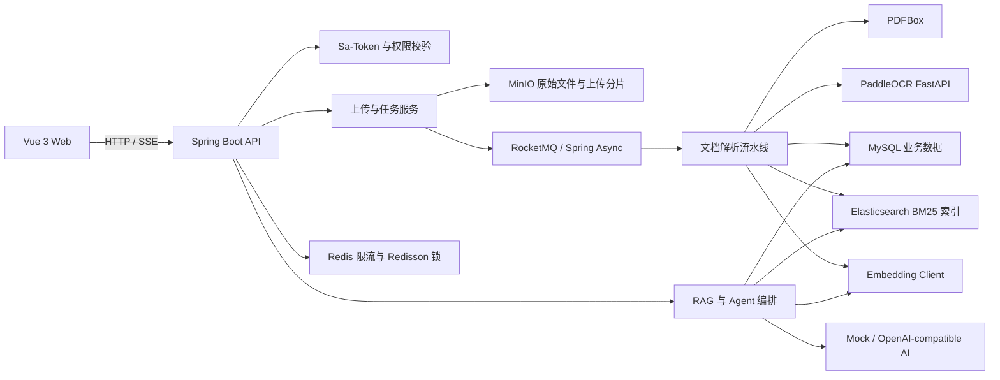

# StudyFlow · 详细项目指南

[← 返回项目首页](../../README.md)

StudyFlow 是一个面向个人学习、团队知识沉淀和私有资料研究场景的智能知识库平台。系统把散落在 PDF、Markdown、TXT 和图片中的内容转换为可检索、可引用、可持续积累的结构化知识，并在此基础上提供全文搜索、混合检索、RAG 问答、来源追踪、质量评估和学习 Agent。

它的重点不是把问题直接转发给大模型，而是完整实现从文件进入系统到可信答案输出的工程链路：大文件分片上传、对象存储、异步解析、PDF/OCR 混合提取、文本切分、向量生成、Elasticsearch 索引、BM25 与向量融合、重排、上下文预算、答案引用校验、会话持久化和 SSE 实时推送。

## 项目解决的问题

学习资料通常存在四类障碍：

- 文件分散：资料保存在不同目录和不同格式中，难以统一组织和检索。
- 内容不可搜索：扫描 PDF、截图和图片没有可直接使用的文本层。
- 检索缺少语义：单纯关键词搜索难以处理同义表达、上下文关联和自然语言问题。
- 回答缺少依据：大模型能够生成流畅文本，但如果没有来源约束，内容难以验证。

StudyFlow 将这些问题拆成一条可观测的数据流水线。原始文件由 MinIO 保存，业务元数据和执行状态由 MySQL 管理，热点状态与流量控制由 Redis 承担，文档分片由 Elasticsearch 提供 BM25 召回，同时使用 embedding 补充语义相似度。最终答案必须绑定实际检索到的分片，用户可以查看文档名、页码、解析方式、匹配分数和引用原文。

## 已验证的工程亮点

本次实现、验收结果及简历表述见[完整验收记录](highlights-verification.md)。

- [可恢复文档处理](durable-document-pipeline.md)：事务 Outbox、阶段检查点、租约 fencing、generation 重建与删除补偿。
- [真实 BGE 混合检索与评测](../../retrieval-lab/README.md)：ES HNSW、Java RRF 和固定模型 revision；保留原生 ES 与 Java API 对照报告。
- [结论与原文证据绑定](claim-evidence-qa.md)：严格协议、引文位置、权限及版本复查、核验失败拒答，前端可查看原文。

2026-10-09 验证：后端开启真实 MySQL/ES 的 66 项测试全部通过，前端构建通过，24 份样例资料完成真实 MinIO/BGE/ES API 链路。问答端到端为 extractive mock；真实生成模型准确率与容量未测。报告见 [API 验证结果](experiments/highlights-e2e-results.json) 和 [检索样例评测](../../retrieval-lab/reports/initial-java-evaluation.md)。

## 核心能力

### 1. 知识库与账号体系

- 用户注册、登录、退出和当前用户查询。
- 使用 BCrypt 保存密码摘要，明文密码不会落库。
- 使用 Sa-Token 管理登录态，业务查询始终按 `userId` 和知识库归属做权限隔离。
- 支持知识库创建、查询、修改、删除以及知识库内文档管理。

### 2. 可靠文件上传

- 支持 PDF、TXT、Markdown、JPG、JPEG、PNG 和 WebP。
- 提供普通 multipart 上传，也提供大文件分片上传接口。
- 分片上传包含初始化、分片校验、进度查询、断点续传和服务端合并流程。
- 每个分片可以校验 MD5，完成阶段再次计算完整文件 MD5。
- 使用 Redisson 分布式锁保证同一个上传会话不会被并发合并多次。
- MinIO Compose 在服务端合并对象，减少应用进程对大文件的内存占用。
- 同一用户的相同文件可以复用原始对象，每份文档建立独立的 generation 和持久处理任务。

### 3. PDFBox 与 PaddleOCR 混合解析

- TXT 和 Markdown 直接使用 UTF-8 文本解析。
- 文本型 PDF 优先通过 PDFBox 按页抽取，速度快且资源消耗低。
- 系统按页统计有效字符数，并检查页面是否包含栅格图像。
- 只有低文本密度且包含图像的页面才进入 PaddleOCR，避免整份 PDF 无差别 OCR。
- 图片文件直接进入独立的 FastAPI + PaddleOCR 服务。
- 解析结果保留页码、解析器类型、OCR 置信度、OCR 页数和耗时。
- 混合 PDF 可以同时包含 `PDFBOX` 与 `PADDLE_OCR` 页面，文档级解析类型记录为 `HYBRID`。

### 4. 文本切分与元数据保留

- 文本经过清洗后按可配置字符窗口切分。
- 默认 `chunk-size` 为 400，`chunk-overlap` 为 60，用重叠区保留跨边界语义。
- 分片保存 `documentId`、`knowledgeBaseId`、`chunkIndex`、字符数、页码和解析器信息。
- OCR 分片继续保存置信度，使搜索结果和引用详情可以展示内容质量线索。
- MySQL 中的分片是业务事实数据，Elasticsearch 中的索引用于快速召回，可以按文档重新构建。

### 5. BM25、向量与轻量重排的混合检索

Elasticsearch 使用显式 CJK 文本分析和 512 维 cosine HNSW mapping，分别执行 BM25 与向量召回，Java 使用 RRF 融合排名（常数 60），避免直接相加不同量纲分数。可选择 BM25、VECTOR、RRF、RRF_LEXICAL 与 LEGACY 五种模式做对照；词面重排和旧 MySQL 向量扫描作为可选实验路径。

CPU BGE 侧车固定模型完整 revision，并区分查询前缀与文档编码。所有权和知识库在 ES 查询前过滤，召回后复查 MySQL 的当前版本及 SUCCESS 状态。新旧模型与 mapping 使用独立索引及文档重建；默认 mock embedding 仅验证运行流程。

### 6. 可追溯 RAG 问答

问答链路包含以下步骤：

```text
用户问题
  -> 登录态与知识库权限校验
  -> 查询改写
  -> 混合检索召回候选分片
  -> 依据 topK 和上下文字符预算选择证据
  -> 构建带来源编号的 RAG Prompt
  -> 调用 AI Client
  -> 严格校验结构化结论、来源和连续原文引文
  -> 独立核验请求与权限/版本复查
  -> 原子保存已核验消息、结论与引用
  -> 返回答案、检索信息、耗时和来源
```

没有可用证据时返回无上下文结果。每条结论绑定来源白名单及连续原文引文，保存 UTF-16 位置、内容摘要和 generation；核验服务错误、超时或判定不足时拒绝发布对应结论。mock 模式仅允许原文摘录并明确标记，模型核验不替代人工准确率评测。文档重建后历史引用标记旧版本，删除后引用详情拒绝读取。

### 7. SSE 实时输出

- 普通问答接口一次性返回完整结果。
- 流式接口使用 Server-Sent Events 推送 `message_start`、`verification_start`、`delta`、`metadata`、`citations` 和 `message_end`。
- OpenAI-compatible 客户端支持读取流式响应并聚合 token 使用信息。
- 服务端聚合模型原始输出，核验及原子保存完成后才发送答案 delta 和元数据，前端展示核验模式与证据。
- Agent 运行也使用 SSE 推送工具开始、步骤完成、运行结束和错误事件。

### 8. 有边界的学习 Agent

StudyFlow 在固定 RAG 流程之上提供结构化 Plan-Execute Agent。模型每一轮只能输出一个 JSON 决策：调用一个白名单工具，或者给出最终答案。

当前只读工具包括：

| 工具 | 作用 | 约束 |
| --- | --- | --- |
| `search_knowledge` | 在当前知识库执行混合检索 | `topK` 有上限，只能访问当前用户数据 |
| `list_documents` | 查看文档、解析状态和摘要 | 复用文档服务的归属校验 |
| `read_document` | 读取指定文档的有限数量分片 | 文档必须属于当前知识库，读取数量受配置限制 |

Agent 具备最大步骤数、重复工具调用检测、历史消息截断、工具结果截断、来源数量限制和工具白名单。每次运行保存 session、run、message、step 和 source，前端可以回放完整执行轨迹。系统只保存面向用户的简短决策摘要，不保存模型的隐式思考过程。

### 9. 异步任务与失败恢复

- 上传事务原子保存 document、parse_task 和 pipeline_outbox，文件存储与阶段外部调用不持有长数据库事务。
- 支持 RocketMQ 生产者/消费者模式，也支持 Spring Async 本地执行模式。
- 任务状态覆盖 `PENDING`、`PROCESSING`、`RETRYING`、`SUCCESS` 和 `FAILED`。
- 失败会记录错误原因、重试次数和完成时间。
- 按 PARSE、EMBED、INDEX 保存检查点；通过数据库领取 token、心跳、过期回收和 Outbox 补扫恢复丢失唤醒。重建/删除采用 generation 与 tombstone，旧 worker 无法发布新版本。

### 10. 流量保护与一致性边界

- Redis + Lua 实现令牌桶限流，一次脚本完成补充令牌、判断、扣减和过期时间更新。
- 限流 key 按接口和用户组织；未登录请求可以使用来源地址作为兜底维度。
- 上传、搜索、问答、检索调试和 Agent 分别配置容量与恢复窗口。
- MySQL 保存业务状态，Elasticsearch 作为派生索引；索引失败不会改变原文件和分片的事实归属。
- Redisson 分布式锁用于解析去重与分片合并，解决多实例下本地锁无法覆盖的问题。

## 系统架构



## 数据处理全链路

### 文档进入系统

```text
选择文件
-> 初始化 upload_session
-> 上传缺失分片并记录 upload_part
-> 校验分片完整性
-> MinIO Compose 合并最终对象
-> 计算完整文件 MD5
-> 创建 document 与 parse_task
-> 发布解析任务
```

### 文档解析与索引

```text
消费 parse_task
-> 获取 MD5 分布式锁
-> 检查可复用解析结果
-> 从 MinIO 读取文件
-> PDFBox / PaddleOCR 提取按页文本
-> 清洗并按重叠窗口切分
-> 批量生成 embedding
-> 保存 document_chunk
-> 生成摘要和关键词
-> 写入 Elasticsearch
-> 更新文档与任务状态
```

### 检索与生成

```text
自然语言问题
-> 查询改写
-> BM25 候选
-> 向量候选
-> 分数融合与重排
-> 上下文预算裁剪
-> AI 生成带来源编号的回答
-> 引用有效性校验
-> 消息与引用持久化
-> HTTP 或 SSE 返回
```

## 技术栈

| 层次 | 技术 | 在项目中的职责 |
| --- | --- | --- |
| Web 前端 | Vue 3、Vite、Element Plus、Axios、Lucide | 登录、知识库管理、分片上传、搜索、问答、引用详情和 Agent 轨迹 |
| 应用框架 | JDK 21、Spring Boot 3.3 | REST API、依赖注入、校验、异步线程池、统一异常处理 |
| 数据访问 | MyBatis-Plus、MySQL 8、Flyway | 业务数据持久化、状态流转、数据库版本迁移 |
| 登录鉴权 | Sa-Token、BCrypt | 登录态管理、接口拦截、密码摘要、用户数据隔离 |
| 缓存与协调 | Redis 7、Redisson、Lua | 分布式限流、解析锁、上传完成锁 |
| 对象存储 | MinIO | 原始文档、临时分片、服务端对象合并 |
| 搜索 | Elasticsearch 8 | 文档分片索引、BM25 全文召回 |
| 文档处理 | PDFBox、PaddleOCR、FastAPI | 文本 PDF 抽取、扫描页和图片识别 |
| 消息任务 | RocketMQ、Spring Async | 解析任务异步化与本地轻量运行模式 |
| AI 能力 | Mock Client、OpenAI-compatible Client | 摘要、查询改写、embedding、RAG 回答和 Agent 决策 |
| 接口文档 | Knife4j、OpenAPI | API 浏览与调试 |
| 验证工具 | JUnit 5、Mockito、PowerShell smoke scripts、JMeter | 单元测试、端到端烟测和负载场景 |
| 本地环境 | Docker Compose | MySQL、Redis、MinIO、Elasticsearch、RocketMQ 和 OCR 服务编排 |

## 代码结构

```text
StudyFlow-project/
├── README.md
├── studyflow/                         # Spring Boot 后端与基础设施
│   ├── docker-compose.yml
│   ├── ocr-service/                   # PaddleOCR + FastAPI 独立服务
│   ├── scripts/                       # 烟测、OCR 调试、JMeter 场景
│   ├── docs/                          # 深入技术文档
│   └── src/main/java/com/studyflow/
│       ├── agent/                     # Agent 编排、工具、步骤与来源
│       ├── ai/                        # AI Client 与流式协议
│       ├── auth/                      # 注册、登录与用户信息
│       ├── common/                    # 统一响应、业务异常、全局异常处理
│       ├── config/                    # 鉴权、CORS、限流、线程池和序列化
│       ├── document/                  # 文档元数据、分片、解析入口
│       ├── embedding/                 # 向量生成、编码和兼容性信息
│       ├── kb/                        # 知识库领域服务
│       ├── mq/                        # RocketMQ 与本地任务发布实现
│       ├── ocr/                       # OCR 客户端和配置
│       ├── qa/                        # 会话、问答、评估和引用
│       ├── rag/                       # 查询改写、召回、重排、Prompt、答案校验
│       ├── search/                    # Elasticsearch 与混合检索
│       ├── storage/                   # MinIO 读写和对象合并
│       ├── task/                      # 解析任务状态机和重试
│       └── upload/                    # 分片上传和断点续传
└── studyflow-web/                     # Vue 3 前端
    └── src/
        ├── App.vue
        ├── api.js
        └── styles.css
```

## 核心数据模型

| 表 | 作用 | 关键数据 |
| --- | --- | --- |
| `sys_user` | 用户账号 | 用户名、密码摘要、昵称、状态 |
| `knowledge_base` | 用户知识空间 | 所有者、名称、描述、状态 |
| `document` | 文档元数据 | 文件名、MD5、MinIO 对象、解析状态、页数、OCR 信息 |
| `parse_task` | 解析任务 | 状态、重试次数、错误信息、开始与完成时间 |
| `document_chunk` | 可检索文本分片 | 内容、顺序、页码、解析器、OCR 置信度、embedding |
| `ai_summary` | 文档摘要 | 摘要、关键词、生成提供方 |
| `upload_session` | 分片上传会话 | 上传进度、文件信息、合并状态、最终对象 |
| `upload_part` | 已上传分片 | 分片序号、大小、MD5、MinIO 临时对象 |
| `qa_session` | 问答会话 | 用户、知识库、标题、状态 |
| `qa_message` | 问答消息 | 角色、内容、模型、token、耗时和错误 |
| `qa_citation` | 回答引用 | 分片、文档、页码、预览、得分 |
| `agent_session` | Agent 多轮会话 | 用户、知识库、标题和状态 |
| `agent_run` | 一次 Agent 执行 | 目标、最终答案、步骤数、模型成本和耗时 |
| `agent_step` | Agent 执行步骤 | 决策、工具、输入输出、状态和耗时 |
| `agent_source` | Agent 证据 | 文档分片、内容预览和得分 |

数据库变更由 Flyway 管理。新增能力通过版本化迁移脚本演进，避免依赖手工修改线上表结构。

## 主要接口

### 账号与知识库

```http
POST   /api/auth/register
POST   /api/auth/login
GET    /api/auth/me
POST   /api/auth/logout

POST   /api/knowledge-bases
GET    /api/knowledge-bases
GET    /api/knowledge-bases/{id}
PUT    /api/knowledge-bases/{id}
DELETE /api/knowledge-bases/{id}
```

### 文档与上传

```http
POST /api/documents/upload
GET  /api/knowledge-bases/{knowledgeBaseId}/documents
GET  /api/documents/{documentId}
GET  /api/documents/{documentId}/chunks

POST /api/uploads/init
POST /api/uploads/{uploadId}/parts
GET  /api/uploads/{uploadId}/parts
POST /api/uploads/{uploadId}/complete
```

### 搜索、问答与评估

```http
GET  /api/search
POST /api/qa/sessions
GET  /api/qa/sessions
GET  /api/qa/sessions/{sessionId}/messages
POST /api/qa/retrieve
POST /api/qa/ask
POST /api/qa/ask/stream
GET  /api/qa/messages/{messageId}/citations
GET  /api/qa/citations/{citationId}/chunk
GET  /api/qa/evaluate/samples
POST /api/qa/evaluate
```

### Agent 与任务

```http
POST /api/agent/runs
POST /api/agent/runs/stream
GET  /api/agent/sessions
GET  /api/agent/sessions/{sessionId}/runs
GET  /api/agent/runs/{runId}

GET  /api/tasks/{taskId}
POST /api/tasks/{taskId}/retry
```

完整接口定义可在后端启动后通过 Knife4j 查看：`http://localhost:8080/doc.html`。

## 本地启动

### 环境要求

- JDK 21
- Maven 3.9+
- Node.js 20+
- Docker Desktop 或兼容 Docker Compose 的环境
- 建议至少预留 6 GB 可用内存；启用 OCR 时需要更多首次构建时间和磁盘空间

### 1. 启动基础设施

```powershell
cd studyflow
docker compose up -d mysql redis minio elasticsearch rocketmq-namesrv rocketmq-broker
```

如果希望使用本地异步线程而不启动 RocketMQ：

```powershell
$env:STUDYFLOW_MQ_MODE="async"
docker compose up -d mysql redis minio elasticsearch
```

### 2. 启动 OCR 服务

文本型 PDF、TXT 和 Markdown 不依赖 OCR。处理扫描 PDF 或图片时启动：

```powershell
docker compose up -d --build paddleocr
Invoke-RestMethod http://localhost:8866/health
```

第一次运行会下载模型，模型和缓存通过 Docker Volume 复用。

### 3. 启动后端

```powershell
mvn spring-boot:run
```

服务地址：

| 服务 | 地址 |
| --- | --- |
| 后端 API | `http://localhost:8080` |
| Knife4j | `http://localhost:8080/doc.html` |
| Elasticsearch | `http://localhost:9200` |
| MinIO API | `http://localhost:9000` |
| MinIO Console | `http://localhost:9001` |
| PaddleOCR | `http://localhost:8866` |

Docker Compose 中的账号仅用于本地开发，请在任何共享或公网环境中通过私有配置替换。

### 4. 启动前端

```powershell
cd ../studyflow-web
npm install
npm run dev
```

浏览器访问：`http://localhost:5173`。

## AI 与 embedding 配置

默认使用确定性的 Mock 实现，不需要外部密钥，上传、索引、检索、问答、引用和 Agent 主链路均可运行。

接入兼容 Chat Completions 和 Embeddings 协议的服务时：

```powershell
$env:STUDYFLOW_AI_PROVIDER="openai-compatible"
$env:STUDYFLOW_AI_BASE_URL="https://api.example.com/v1"
$env:STUDYFLOW_AI_API_KEY="your-api-key"
$env:STUDYFLOW_AI_MODEL="your-chat-model"

$env:STUDYFLOW_EMBEDDING_PROVIDER="openai-compatible"
$env:STUDYFLOW_EMBEDDING_BASE_URL="https://api.example.com/v1"
$env:STUDYFLOW_EMBEDDING_API_KEY="your-api-key"
$env:STUDYFLOW_EMBEDDING_MODEL="your-embedding-model"
$env:STUDYFLOW_EMBEDDING_DIMENSION="512"
```

密钥只通过环境变量或未提交的本地配置注入，不应写进仓库。

## 验证与测试

### 后端单元测试

```powershell
cd studyflow
mvn test
```

测试覆盖结构化 Agent 决策解析、全局异常处理、限流拦截器、OCR 分流、embedding 编解码、向量兼容性、答案引用校验和轻量重排等关键逻辑。

### 前端生产构建

```powershell
cd studyflow-web
npm run build
```

### 端到端烟测

```powershell
cd studyflow
powershell -ExecutionPolicy Bypass -File scripts\smoke-v4.ps1
```

脚本会完成账号创建、登录、知识库创建、文档上传、任务轮询、RAG 召回、问答、引用详情和 SSE 事件验证。

### OCR 独立验证

```powershell
powershell -ExecutionPolicy Bypass -File scripts\ocr-service-demo.ps1 -File "C:\path\to\document.png"
```

### 负载场景

`studyflow/scripts/jmeter-studyflow-basic.jmx` 提供基础请求场景，可用于观察限流、错误率、吞吐量和响应时间。生成的 `.jtl`、日志和 HTML 报告不进入版本库。

## 项目价值

### 对个人学习

- 把文件夹式资料管理升级为可检索的知识网络。
- 通过来源页码和原文降低核对成本，减少不可信回答带来的干扰。
- 让用户能够从搜索、问答进一步进入总结、对比和学习计划等复合任务。
- 保留历史会话和 Agent 运行记录，形成持续积累的学习轨迹。

### 对团队知识管理

- 可以作为内部文档、规范、研究报告和操作手册的统一入口。
- 权限边界、引用追踪和运行轨迹为后续审计与治理提供基础。
- AI Client、Embedding Client、任务发布器和 Agent 工具均通过接口抽象，便于替换供应商或基础设施。
- 文档处理链路模块化，后续可以扩展 Office、网页、音视频转写等数据源。

### 对工程实践

- 展示了异构存储协作：MySQL 管事实、MinIO 管文件、Elasticsearch 管搜索、Redis 管协调。
- 展示了 AI 应用需要的非模型能力：数据清洗、检索质量、上下文预算、引用校验、降级、限流和可观测性。
- 同时提供 Mock 与外部服务模式，降低本地运行门槛，并为自动化测试保留确定性。
- 使用版本化迁移、状态机、分布式锁和幂等设计，避免系统只在单次演示路径上可用。

## 当前边界

- 当前真实 BGE 检索评测仅为 24 分片、22 道 test 问题；需要独立标注和真实查询集验证泛化能力。
- 分片/索引删除已有持久清理与旧版本对账；共享原始对象的引用计数与保留策略尚未实现。
- 现阶段主要是单租户用户隔离模型，组织、角色、共享知识库和细粒度权限仍需扩展。
- OCR 使用 CPU 默认配置，批量高并发识别需要 GPU、任务队列、资源配额和独立伸缩策略。
- Agent 当前只开放只读工具；写操作需要加入审批、幂等键和撤销机制。
- 运行指标主要保存在业务表和日志中，尚未完成 Prometheus、Grafana 与分布式追踪接入。

## 发展路线

### 阶段一：检索质量与评估体系

- 在原生 ES 向量索引基础上验证更大规模数据、过滤选择性和独立排序模型。
- 引入跨编码器或外部 rerank 服务，提高候选排序质量。
- 建立可版本化的评测集，持续统计 Recall@K、MRR、引用命中率、无依据回答率和人工评分。
- 增加文档级过滤、标签过滤、时间过滤和权限过滤，并记录每次检索的参数快照。

### 阶段二：文档工程能力

- 增加 DOCX、PPTX、XLSX、HTML、EPUB 和网页采集。
- 对标题、段落、表格、代码块、公式和图片说明做结构化解析，不再只依赖字符窗口。
- 在现有 generation 重建基础上完善 parser/chunker 版本缓存与索引 alias 灰度切换。
- 为 OCR 增加版面分析、表格识别、方向检测、置信度阈值和人工校正流程。

### 阶段三：任务系统与可靠性

- 已拆分解析、embedding、索引及清理；继续将摘要从 PARSE 中移为独立支线，并实现大文件流式处理。
- 已采用事务 Outbox；补充真实 RocketMQ 集群故障与多实例容量实验。
- 支持任务取消、超时、死信队列、指数退避、幂等消费和失败补偿。
- 增加索引对账和自动修复，定期检查 MySQL 分片与 Elasticsearch 文档差异。

### 阶段四：Agent 与学习闭环

- 从 JSON 决策协议升级到原生 function calling，同时保持工具注册层不变。
- 增加生成测验、保存学习计划、创建复习卡片、更新学习进度等受控写工具。
- 对写工具引入用户确认、权限策略、幂等键、审计日志和撤销能力。
- 增加长期记忆摘要、任务路由、多 Agent 协作和执行成本预算。
- 建立任务完成率、平均步骤数、无效工具率、来源覆盖率和单位任务成本指标。

### 阶段五：平台化与部署

- 增加组织、成员、角色、共享空间和文档级访问控制。
- 使用 S3、云数据库、托管 Elasticsearch 和 Kubernetes 支持多环境部署。
- 接入 OpenTelemetry、Prometheus、Grafana 和集中日志平台。
- 增加 CI/CD、镜像扫描、依赖漏洞检查、数据库备份和灾难恢复演练。
- 支持多模型路由、调用熔断、超时降级、成本上限和敏感数据脱敏。

## 深入文档

- [后端运行与接口说明](../README.md)
- [技术架构与关键设计](TECHNICAL_ARCHITECTURE.md)
- [学习 Agent 设计](LEARNING_AGENT.md)
- [前端说明](../../studyflow-web/README.md)

## 安全说明

仓库不包含真实外部服务密钥。默认数据库与 MinIO 口令仅面向本地 Docker Compose 环境，不适用于公网部署。生产环境应使用密钥管理系统、私有网络、TLS、最小权限账号、访问审计和定期轮换策略。
